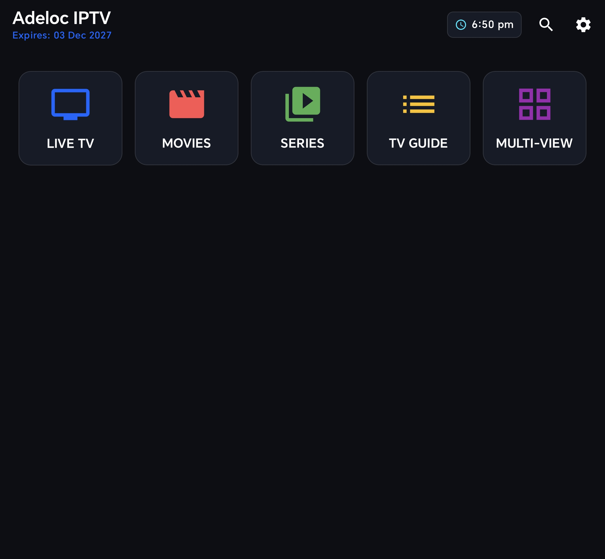
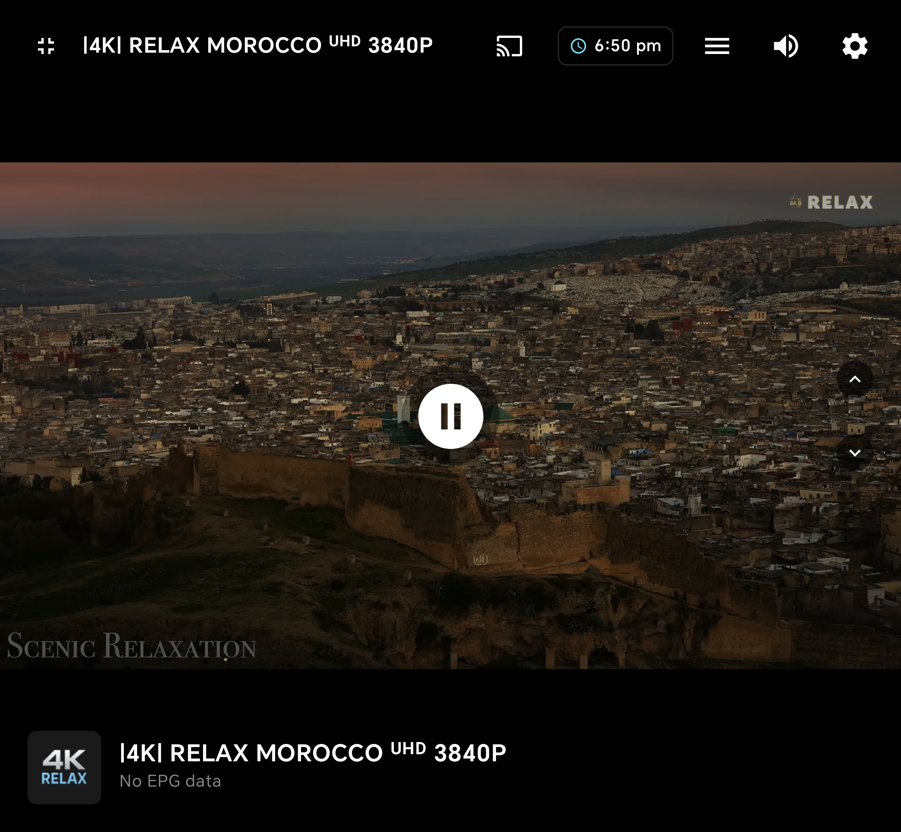
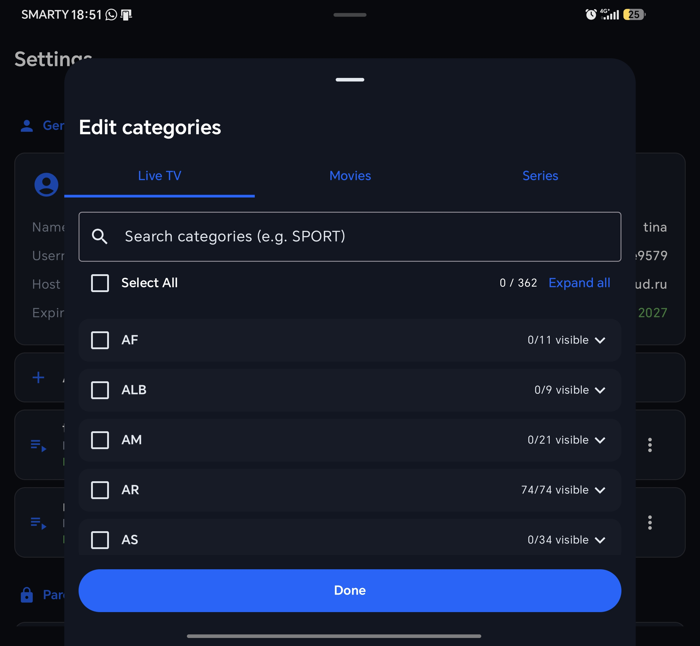
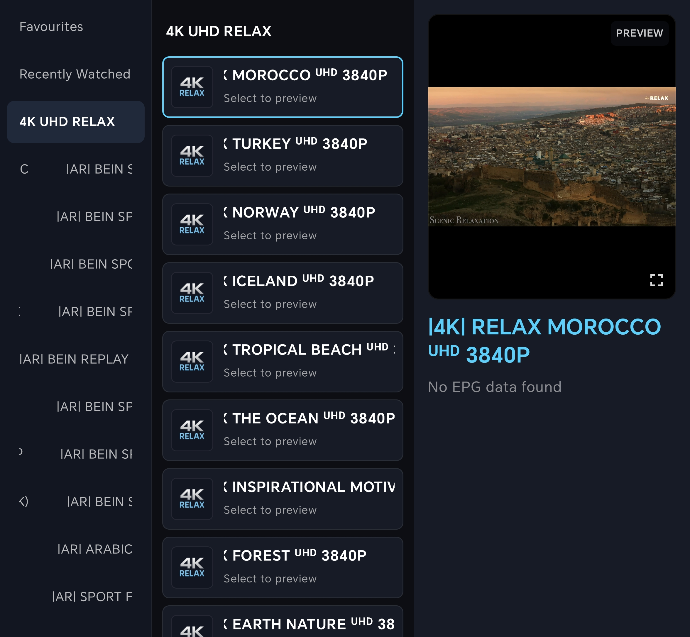

# Adeloc IPTV 📺✨

A premium, high-performance Android & Android TV media player built from the ground up using **Jetpack Compose** and **Media3 ExoPlayer**. Engineered for power users, Adeloc IPTV delivers a fast, clutter-free, and cinematic viewing experience with native TV remote control support.

---

## 📸 Screenshots

| Home & Live TV | Player & EPG | Smart Playlist Manager |
| :---: | :---: | :---: | :---: |
|  |  |  |  |

---

## 🚀 Key Features

* 📺 **Full Android TV & Phone Support**: Seamless D-Pad navigation for TV remotes alongside touch/gesture controls for smartphones and tablets.
* ⚡ **Advanced ExoPlayer Engine**: Native hardware decoding for complex audio codecs (AC3, E-AC3, DTS) ensuring ultra-smooth playback without sync drops.
* 🗂️ **Smart Playlist & Category Management**:
  * Multi-playlist support for M3U and Xtream Codes (XC) API.
  * Smart category grouping by country/region tags (UK, US, IT, NL, AR, SPORT).
  * Bulk category management with real-time search, multi-selection, and instant batch visibility toggling.
* 🔁 **Binge Mode & Resume Playback**: Auto-play next episode for TV series, with persistent playback state tracking for instant resume.
* 📺 **Double-Tap Preview Player**: Single-tap to preview any Live TV channel in the sidebar layout, double-tap for immediate full-screen immersion.
* 📡 **Live Sync Indicator**: Non-blocking background sync banner for EPG and channel data on fresh app opens.
* 🗓️ **Dynamic EPG Guide**: Integrated Electronic Program Guide with local caching and custom time offsets.
* 🔒 **Parental Controls & Security**: PIN-protected categories for locking sensitive channels.

---

## 🛠️ Built With

* **Language**: 100% Modern Kotlin
* **UI Toolkit**: Jetpack Compose (Declarative TV & Mobile UI)
* **Playback Engine**: AndroidX Media3 (ExoPlayer)
* **Networking**: Retrofit 2.11.0 & Gson (R8 full-mode optimized)
* **Concurrency**: Kotlin Coroutines & Flow for reactive state management

---

## 📄 License

This project is licensed under the MIT License - see the [LICENSE](LICENSE) file for details.
